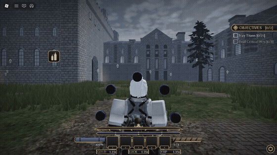

# AoTR Agent

A research project on imitation learning for **Attack on Titan Revolution** (Roblox). The agent sees only the screen, the way a player does, and sends keyboard and mouse input through a virtual device. No game files, no memory reading, no client modification.

The point is to learn game AI end to end: data collection, dataset design, model training, and running a policy in a live game under real latency limits.

**Status: early. The agent moves, flies, hooks, and turns toward titans. It does not land hits yet.**



[Full 52-second clip](docs/demo_full.gif) (8.8 MB, 5 fps)

## How it works

```
screen (Wayland) ──► grim ──► 96×54 RGB, 4-frame stack
                                        │
                                        ▼
                              small CNN (313k params)
                                   │           │
                              keys (12)    mouse: 9 directions + magnitude
                                   │           │
                                   ▼           ▼
                         /dev/uinput virtual keyboard and mouse
```

Training is behaviour cloning: the model learns to reproduce the actions of a human player from recorded frames. Corrections are collected with DAgger, where the human takes over whenever the policy fails.

## Results so far

Trained on about one hour of gameplay, 54k training samples, CPU only (i5-7400, no GPU).

| Version | Input | Mouse | Key F1 | Notes |
|---|---|---|---|---|
| v0 | 96×54 gray, 4 frames | delta regression | 0.43 | first working policy |
| v2 | 128×72 color, 4 frames | delta regression | 0.57 | plays, but camera drifts |
| GRU | 128×72 color, sequences | delta regression | 0.44 | worse, needs more data |
| disc | 96×54 color, 4 frames | 9-way classification | 0.53 | direction accuracy 42%, camera aims at titans |

In live runs the latest model flies, hooks, and faces titans. In the last recorded run it dealt 0 damage, so aiming and strike timing are still unsolved.

## What did not work

**Titan detector.** A separate CNN was trained to output a heatmap of titan positions on 300 hand-labelled frames. Best result: precision 0.47, recall 0.68. The signal correlated negatively with where the human turned the camera, which means it was firing on trees and fog. Closed for now. See `docs/experiments.md`.

**Higher resolution from scratch.** 320×180 models collapsed to a near-constant prediction because positive heatmap cells are under 0.3% of the image. The bug that made it worse was full-batch training, which was fixed, but 300 frames remain too few.

## Quick start

Tested on Arch Linux with Hyprland and a Roblox client running through Sober. Requirements:

- Python 3.12
- `grim`, `ffmpeg`
- read access to `/dev/input/event*` (for recording) and write access to `/dev/uinput`
- `hyprctl` for window focus checks

```bash
# environment
uv venv --python 3.12 .venv
uv pip install --python .venv/bin/python -r requirements.txt

# record a session: F7 start/stop, F8 exit
cd harness
python3 -u record.py --out ~/aotr-data --tag "my-session"

# build a dataset
python3 -u dataset.py ~/aotr-data/episode_0001 \
  --width 96 --height 54 --stack 4 --color --npy --mouse discrete \
  --out ~/aotr-data/datasets/ds_e1

# train
cd ..
.venv/bin/python train.py ~/aotr-data/datasets/ds_e1 \
  --epochs 10 --batch 64 --device cpu --out checkpoints/policy.pt

# play: F8 or Esc to stop
.venv/bin/python play.py checkpoints/policy.pt --threshold 0.45 --search
```

## Project layout

```
harness/    screen capture, virtual input, recording, dataset builder
detector/   titan detector experiments (code only, no weights)
tools/      dataset merging
kaggle/     free GPU training notebook
docs/       experiment log
play.py     runs a policy in the game
train.py    behaviour cloning trainer (CNN and GRU)
```

## Limitations

- About one hour of human data. Continuous control usually needs more.
- Input is 96×54. The nape of a distant titan is a few pixels.
- No memory beyond four frames, so the agent forgets targets that leave the screen.
- No explicit goal signal. The titan detector that was supposed to provide one did not work.
- Menus at the end of a mission are not handled, so the agent stops there.

## Roadmap

1. More demonstrations and DAgger rounds.
2. Higher input resolution with GPU training.
3. Optional goal signal from a better detector or a private place copy.
4. Thunder Spears and titan shifting as additional input modes.

## Ethics

This is a research project about learning from pixels. It is not affiliated with Roblox or the AoTR team. Automating gameplay on public servers violates Roblox rules, so the intended environment is a private server or a private copy of the place. The code is published for study, not for cheating.

## Acknowledgements

Game mechanics reference: the official Attack on Titan Revolution wiki. Built with PyTorch. Screen capture uses `grim`, input uses Linux `uinput`.
